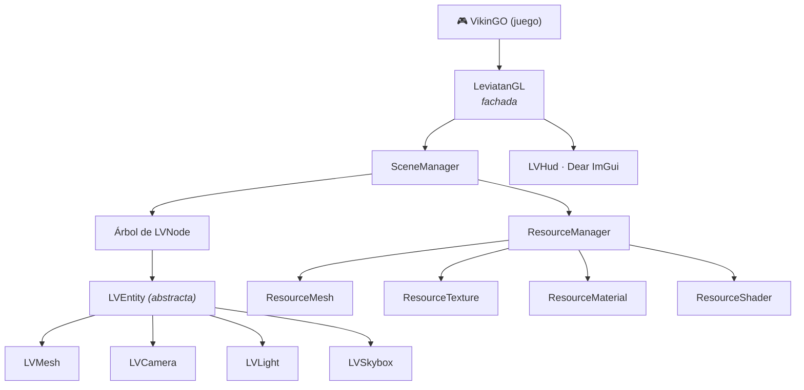

<div align="center">

# 🐉 LeviatanGL

**Motor gráfico 3D propio escrito en C++ moderno sobre OpenGL 3.3**

Desarrollado desde cero para el videojuego **VikinGO**


</div>

---

## ✨ Qué es

LeviatanGL es el motor gráfico que construimos para **[VikinGO](https://github.com/Juankilool26/VikinGO)**, el videojuego del equipo **Aesir Rune** (Universidad de Alicante, curso 2020-2021).

El juego no habla nunca con OpenGL directamente. Todo pasa por una **fachada** (`LVGL::LeviatanGL`) que expone operaciones de alto nivel, como crear un nodo, mover la cámara o pintar el HUD. Por debajo, el motor organiza la escena en un **árbol de nodos** y gestiona la memoria con **smart pointers** (`std::unique_ptr` y `std::shared_ptr`), sin `delete` manuales en el código del juego.

## 🧩 Características

| Área | Qué hace |
|---|---|
| **Grafo de escena** | Árbol jerárquico de nodos con traslación, rotación y escalado. Cada hijo hereda la transformación de su padre. |
| **Dirty flag** | Al mover un nodo se marca como modificado junto con todo su subárbol, y las matrices solo se recalculan cuando algo ha cambiado. |
| **Entidades** | Clase abstracta `LVEntity` con `Render()` polimórfico, de la que heredan mallas, cámaras, luces, skybox y elementos del HUD. |
| **Iluminación** | Luces direccionales, puntuales y focales con componentes ambiente, difusa y especular, atenuación por distancia y conos de corte suaves. |
| **Cámara** | Cámara en primera persona controlada con el ratón, con proyección en perspectiva o paralela. |
| **Animación** | Animación por keyframes, con secuencias de mallas y reproducción en bucle. |
| **Skybox** | Cubemap de seis caras con su propio par de shaders. |
| **Gestor de recursos** | Caché centralizada de mallas, texturas, materiales y shaders: cada recurso se carga una sola vez y se reutiliza. |
| **HUD y menús** | Interfaz del juego (vida, estamina, sigilo, diálogos, pausa y menús) con Dear ImGui. |

## 🏗️ Arquitectura



**Patrones de diseño aplicados**

- **Fachada:** `LeviatanGL` es el único punto de entrada para el juego y oculta GLFW, GLEW y OpenGL.
- **Composite:** cada `LVNode` contiene una entidad y sus hijos, y pintar la escena es recorrer el árbol.
- **Singleton:** `SceneManager` y `ResourceManager` tienen una única instancia compartida por todo el motor.
- **Polimorfismo:** cada tipo de entidad implementa su propio `Render()` sobre la interfaz común `LVEntity`.

## 🚀 Ejemplo de uso

```cpp
#include "LeviatanGL.hpp"

int main() {
    LVGL::LeviatanGL engine(1280, 720, "VikinGO");

    engine.setSkybox("right.jpg", "left.jpg", "top.jpg",
                     "bottom.jpg", "front.jpg", "back.jpg");

    // Cámara en primera persona: posición y punto al que mira
    engine.createFPSCameraNode(0, {0.f, 2.f, 8.f}, {0.f, 0.f, 0.f});

    // Malla estática: id, traslación, rotación y modelo .obj
    engine.createStaticNode(1, {0.f, 0.f, 0.f}, {0.f, 0.f, 0.f}, "assets/drakkar.obj");

    while (engine.isDeviceRunning()) {
        engine.update(engine.getWindow(), 1.f / 60.f);
    }

    engine.dropDevice();
}
```

## 📁 Estructura

```
LeviatanGL/
├── src/
│   ├── LeviatanGL.hpp / .cpp     → fachada del motor
│   ├── manager/                  → ResourceManager y recursos (mesh, texture, material, shader)
│   └── scene/
│       ├── Tree/                 → LVNode, LVEntity, LVMesh, LVCamera, LVLight, LVSkybox, LVHud
│       └── Shader/               → shaders GLSL de la escena y del skybox
├── lib/                          → GLEW, GLFW, GLM, Dear ImGui, stb_image, cargador OBJ
└── Makefile
```

## 🔧 Compilación

El motor se compila como librería estática (`leviatanGL.a`) con `g++` en C++17:

```bash
make            # build optimizado (-O3)
make DEBUG=1    # build con símbolos de depuración
make clean      # borra los objetos intermedios
```

## 🛠️ Stack

`C++17` · `OpenGL 3.3 Core` · `GLSL` · `GLFW` · `GLEW` · `GLM` · `Dear ImGui` · `stb_image` · `Make`

---

<div align="center">

Hecho con ⚔️ por el equipo **Aesir Rune**: parte de **[VikinGO](https://github.com/Juankilool26/VikinGO)**

</div>
